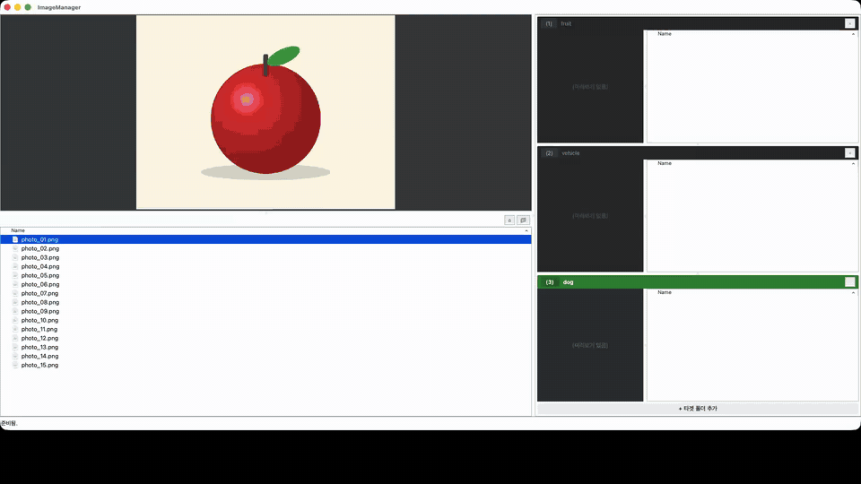
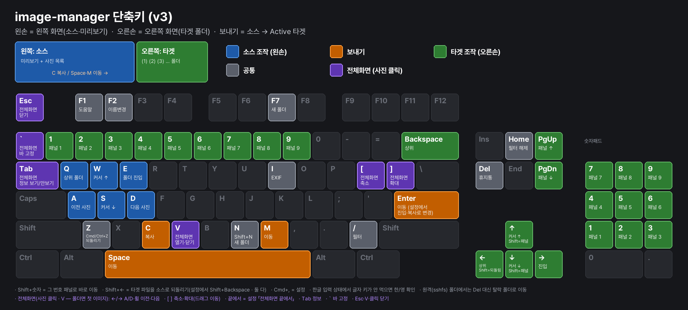

# ImageManager

키보드만으로 사진을 넘겨 보며 여러 폴더로 분류하는 듀얼 패널 이미지 관리자입니다.
왼손은 사진 넘기기, 오른손은 보낼 폴더 고르기 — 양손을 동시에 씁니다.

## ⬇ 다운로드 (설치 없이 바로 실행)

| macOS | Windows | Linux |
|:--:|:--:|:--:|
| [**ImageManager-mac.zip**](https://github.com/sun5022/image-manager/releases/latest/download/ImageManager-mac.zip) | [**ImageManager-windows.zip**](https://github.com/sun5022/image-manager/releases/latest/download/ImageManager-windows.zip) | [**ImageManager-linux.tar.gz**](https://github.com/sun5022/image-manager/releases/latest/download/ImageManager-linux.tar.gz) |
| 압축 풀고 「응용 프로그램」으로 | 압축 풀고 `ImageManager.exe` 실행 | 압축 풀고 `ImageManager/ImageManager` 실행 |

항상 최신 판이 받아집니다. 지난 판 · 해시(SHA256SUMS.txt) = [Releases](https://github.com/sun5022/image-manager/releases)



시연 영상 원본(MP4, 23초): [images/demo.mp4](images/demo.mp4)

- 무료 · 오픈소스 (Apache License 2.0)
- macOS · Linux · Windows
- 개발: 유데브앱 최형선 (UDevApp, HyungSun Choi) — <https://udevapp.co.kr>

## 특징

- **타겟 폴더 여러 개** — 오른쪽에 폴더 패널을 원하는 만큼 쌓고, 패널 안에서 하위 폴더까지 트리로 탐색
- **패널마다 미니 프리뷰** — 어느 폴더에 무엇이 들어 있는지 바로 확인
- **양손 분리 키 배치** — 왼손 WASD 는 화살표처럼(W/S 위아래 · A 상위 · D 진입) = 소스, 오른손(화살표·1~9) = 타겟 폴더. 키가 겹치지 않음
- **보내기 한 번** — `Space` 이동 / `C` 복사, 이동 후 다음 사진 자동 선택
- **숫자 한 번에 분류** — `Shift+1~9` = 그 번호 폴더로 바로 이동
- **Enter 로 이동** — 오른손만으로 분류. 설정에서 폴더 진입 · 복사로 바꿀 수 있음
- **모든 작업 되돌리기** — `Cmd+Z`(Win·Linux `Ctrl+Z`)로 복사·이동·휴지통 삭제까지 복원
- **소스로 되돌리기** — 잘못 분류한 사진은 타겟에서 `Shift+←` 로 다시 왼쪽으로
- **같은 이름 충돌 창** — 덮어쓰기 / 건너뛰기 / 이름 바꾸기 선택
- **압축파일 안으로 진입** — zip · cbz · rar · cbr · 7z · cb7
- **한글 입력 상태에서도 단축키 동작** (macOS)
- EXIF 보기(`I`), 정규식 필터(`/`), 이름 변경(`F2`), 새 폴더(`F7`)

## 단축키

`F1` 을 누르면 앱 안에서 배치도가 뜹니다.



**왼손 — 왼쪽 사진 목록 (소스)**

| 키 | 동작 |
|----|------|
| W / S | 커서 위 / 아래 |
| A | 상위 폴더 (압축파일 안이면 압축파일이 있던 폴더로) |
| D | 폴더 · 압축파일 진입 |
| Q / E | 이전 / 다음 사진 (폴더는 건너뜀) |

**보내기 — 고른 사진 → 오른쪽 활성 폴더**

| 키 | 동작 |
|----|------|
| Space / M | **이동** — 이동 후 다음 사진 자동 선택 |
| C | **복사** |
| Shift + 1 ~ 9 | 그 번호 폴더로 **바로 이동** (숫자열) |

**오른손 — 오른쪽 타겟 폴더**

| 키 | 동작 |
|----|------|
| ↑ / ↓ | 폴더 안에서 커서 위 / 아래 — 끝에 닿으면 이전 · 다음 타겟 패널로 |
| Shift + ↑ / ↓ | 위 / 아래 타겟 패널로 전환 |
| ← / Backspace | 상위 폴더 |
| **Shift + ←** | 커서에 있는 파일을 왼쪽 소스 폴더로 **되돌리기** (이동, 설정에서 Shift + Backspace 로 변경) |
| → | 하위 폴더 진입 |
| Enter | **이동** (설정에서 폴더 진입 · 복사로 변경) |
| 1 ~ 9 | 그 번호 폴더 패널 선택 (숫자패드도 됨) |
| PgUp / PgDn | 위 / 아래 패널로 전환 |

타겟 패널을 고르면 보낼 곳은 그 패널 폴더입니다. ↓ 로 하위 폴더에 커서를 놓으면 그 하위 폴더로 보내집니다.

**공통**

| 키 | 동작 |
|----|------|
| Cmd + Z (Win·Linux: Ctrl + Z) | 되돌리기 (복사 · 이동 · 휴지통 모두) |
| Del | 휴지통 (macOS 는 미리보기 확인 창, `Cmd+Backspace` 도 됨) |
| F2 | 이름 변경 |
| F7 / Shift + N | 새 폴더 |
| I | EXIF 정보 보기 |
| / | 파일 이름 필터 (정규식) — Enter = 필터 건 채 목록으로 · Esc / Home = 필터 해제 |
| V | 전체화면 보기 (폴더면 첫 이미지부터) |
| F1 | 단축키 배치도 |
| Cmd + , (Win·Linux: Ctrl + ,) | 설정 — Enter 키 동작 · 소스로 되돌리기 키 |

한글 입력 상태에서도 단축키가 동작합니다(macOS). 다른 OS 에서 글자 키가 안 먹으면 한/영을 확인하세요.

## 전체화면 보기

미리보기 사진을 **클릭**하거나 **V** 를 누르면 전체화면으로 봅니다(커서가 폴더면 그 안 첫 이미지부터).

| 키 · 마우스 | 동작 |
|------|------|
| ← / → · A / D · 휠 | 이전 / 다음 이미지 (끝에서는 설정대로: 처음으로 · 다음 폴더 · 멈춤) |
| [ / ] · 하단 바 − + | 축소 / 확대 |
| 드래그 | 확대 중 이동 |
| Tab | 정보 카드 보기 / 안 보기 |
| ` | 하단 바 고정 |
| Esc · V · 클릭 | 닫기 |

## 해시 확인 · 처음 실행할 때

받은 파일이 올린 파일과 같은지 **SHA-256 해시**로 확인할 수 있습니다. 판마다 값은 각 릴리스의 `SHA256SUMS.txt` 에 있습니다.

| OS | 확인 명령 |
|----|-----------|
| macOS | `shasum -a 256 ImageManager-mac.zip` |
| Windows (PowerShell) | `Get-FileHash ImageManager-windows.zip -Algorithm SHA256` |
| Windows (명령 프롬프트) | `certutil -hashfile ImageManager-windows.zip SHA256` |
| Linux | `sha256sum ImageManager-linux.tar.gz` |

명령 대신 웹에서 확인하려면:
- [Online SHA256 File Checksum](https://emn178.github.io/online-tools/sha256_checksum.html) — 파일을 끌어다 놓으면 브라우저 안에서 계산합니다(파일이 서버로 올라가지 않음)
- [VirusTotal](https://www.virustotal.com) — 해시 값으로 검색하면 악성코드 검사 결과도 볼 수 있습니다(파일을 직접 올리면 그 파일이 공개되니, 해시 검색을 권합니다)

**처음 실행할 때**
- **macOS** — 개인 인증서로 서명했고 Apple 공증은 받지 않아서 「확인되지 않은 개발자」 경고가 뜹니다. 시스템 설정 → 개인정보 보호 및 보안 → 아래쪽 「그래도 열기」(한 번만). 서명 확인: `codesign -dv /Applications/ImageManager.app` → `Identifier=com.udevapp.ImageManager` (인증서 「UDevApp Code Signing」 SHA-256 지문 `7B:80:FB:07:11:2F:06:46:03:F8:E0:74:AE:8A:CD:E6:82:4B:63:93:09:6C:39:44:61:63:15:8D:80:74:8C:24`)
- **Windows** — 서명하지 않은 프로그램이라 「Windows의 PC 보호」 창이 뜹니다. **추가 정보 → 실행**을 누르면 됩니다(한 번만)
- **Linux** — 화면 라이브러리가 없으면 `sudo apt install libxcb-cursor0` (Ubuntu 22.04 기준)

## 설치와 실행

Python 3.10 ~ 3.13 이 필요합니다 (PySide6 휠 기준).

```bash
git clone https://github.com/sun5022/image-manager.git
cd image-manager
python3 -m venv .venv
.venv/bin/pip install -r requirements.txt        # Windows: .venv\Scripts\pip install -r requirements.txt

# macOS · Linux
.venv/bin/python image_manager.py
# Windows (pythonw = 터미널 창 없이)
.venv\Scripts\pythonw image_manager.py
```

- rar 압축을 열려면 `unrar` 가 필요합니다 (macOS `brew install unrar`, Ubuntu `sudo apt install unrar`)
- Linux 에서 xcb 오류가 나면 `sudo apt install libxcb-cursor0`

### 시작 폴더 지정

```bash
python3 image_manager.py <폴더|파일> [-t 타겟폴더 ...]
```

- 폴더를 주면 그 폴더를, 파일을 주면 부모 폴더를 열고 그 파일에 커서를 둡니다
- `-t` 로 오른쪽 타겟 패널을 지정합니다 (여러 번 가능)
- 인자가 없으면 지난번에 쓰던 폴더로 열립니다

## 연습용 샘플

`sample/unsorted/` 에 과일 · 탈것 · 강아지 그림 15장이 섞여 있습니다. 직접 그린 그림이라 자유롭게 써도 됩니다.

```bash
.venv/bin/python image_manager.py sample/unsorted -t sample/fruit -t sample/vehicle -t sample/dog
```

`1`·`2`·`3` 으로 폴더를 고르고 `Space` 로 보내거나, `Shift+1`·`Shift+2`·`Shift+3` 으로 한 번에 보내 보세요. 실수하면 `Cmd+Z`(Win·Linux `Ctrl+Z`), 예전에 분류한 사진은 타겟에서 `Shift+←`.

## 코드 구조

- `imagemanager/app.py` — 모든 OS 공통 코드 한 벌
- `imagemanager/platforms/` — OS마다 다른 부분만 (`mac.py` · `linux.py` · `windows.py`: 휴지통 · 삭제 확인 · 한글 입력 단축키 등)
- `tests/test_offscreen.py` — 화면 없이 도는 회귀 테스트 (`python tests/test_offscreen.py`)

## 후원

무료로 쓰셔도 됩니다. 도움이 됐다면 [후원 페이지](https://udevapp.co.kr/donate/)(카카오페이)에서 응원해 주세요. 별(★)이나 의견도 큰 힘이 됩니다.

## 라이선스

Apache License 2.0 — [LICENSE](LICENSE) · [NOTICE](NOTICE)

Copyright 2026 유데브앱 최형선 (UDevApp, HyungSun Choi)
